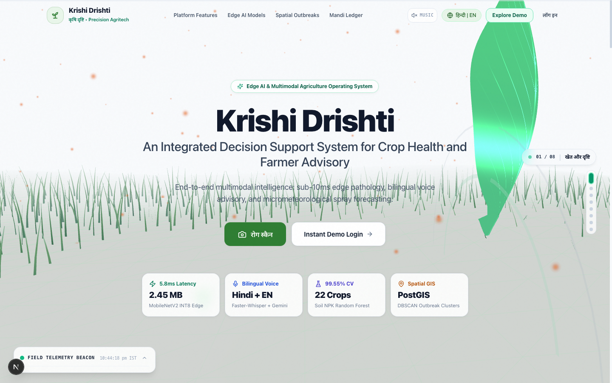
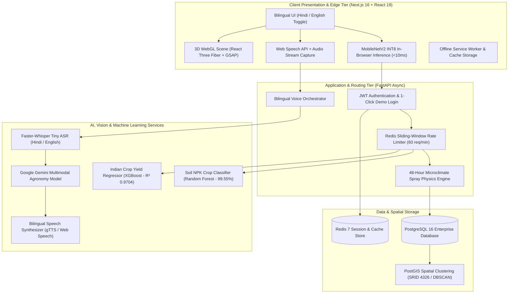
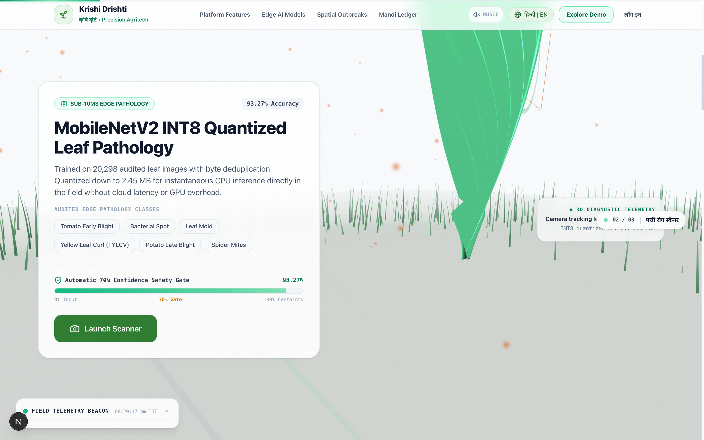
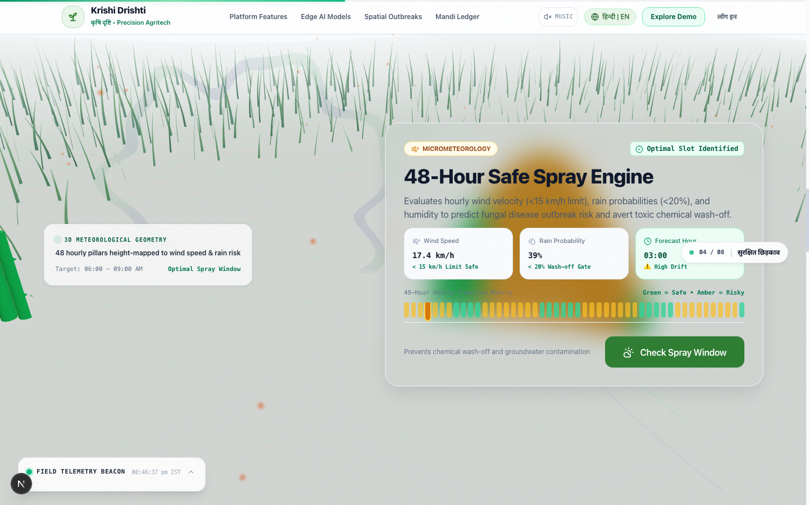
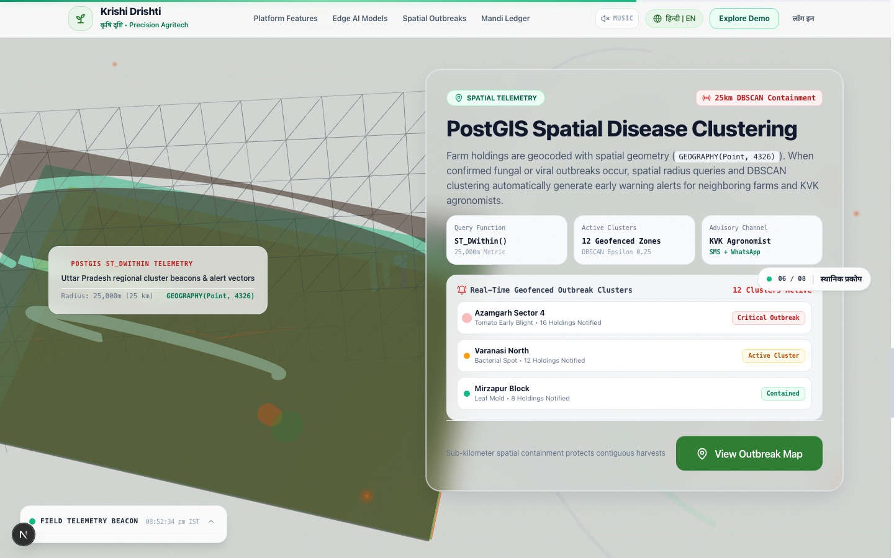
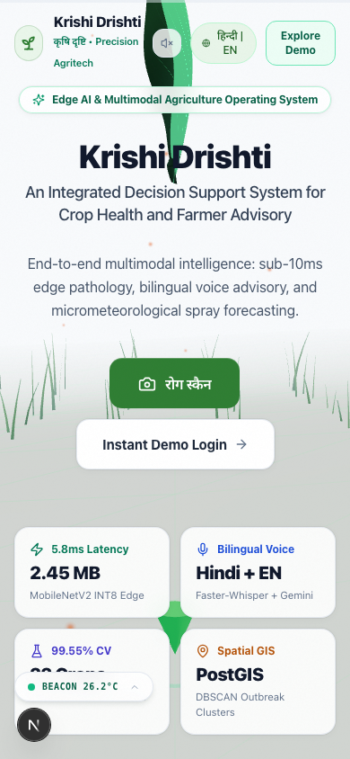

<div align="center">

# 🌾 Krishi Drishti (कृषि दृष्टि)
### *An Integrated Decision Support System for Crop Health and Farmer Advisory*

[](https://nextjs.org/)
[](https://react.dev/)
[](https://threejs.org/)
[](https://fastapi.tiangolo.com)
[](https://postgis.net/)
[](https://redis.io/)
[](https://ai.google.dev/)
[](LICENSE)

<br />

<p align="center">
  <b>An award-level, offline-capable, multimodal precision agritech web platform engineered for 140M+ Indian smallholder farmers.</b><br />
  Featuring sub-10ms edge leaf pathology, bilingual vernacular voice telephony, 48-hour microclimate safe spray windows, PostGIS spatial outbreak clustering, and an interactive scroll-driven 3D WebGL experience.
</p>

<br />



</div>

---

## 📑 Table of Contents

- [The Challenge](#-the-challenge)
- [System Architecture](#-system-architecture)
- [Key Engineering Innovations](#-key-engineering-innovations)
- [Interactive 3D Visual Experience](#-interactive-3d-visual-experience)
- [Visual Showcase](#-visual-showcase)
- [Quick Start & Local Setup](#-quick-start--local-setup)
- [API Reference](#-api-reference)
- [ML Models & Agronomic Datasets](#-ml-models--agronomic-datasets)
- [Viva & Academic Defense](#-viva--academic-defense)
- [License & Acknowledgments](#-license--acknowledgments)

---

## 🚨 The Challenge

Agriculture sustains over **58% of India's rural population**, with **86% operating smallholdings** under 2 hectares. Smallholder farmers face four critical bottlenecks that lead to an estimated **15% to 30% annual crop loss**:

> [!IMPORTANT]
> 1. **Pathology Identification Latency:** Turnaround time for extension officers or Krishi Vigyan Kendra (KVK) visits is 4–10 days. Late fungal diagnostics reduce yields by up to 50%.
> 2. **Linguistic & Interface Barriers:** Complex English dashboards exclude rural smallholders who require spoken, vernacular dialogue in Hindi and regional dialects.
> 3. **Indiscriminate Chemical Spraying:** Applying pesticides immediately before monsoon showers washes ₹3,000–₹5,000 per acre into waterways, producing groundwater toxicity and debt.
> 4. **Mandi Price Opacity:** Lack of live APMC market intelligence enables intermediaries to extract 25–40% margins from farmer earnings.

**Krishi Drishti** bridges these gaps by pairing high-performance edge machine learning with zero-latency visual computing and conversational telephony.

---

## 🏗️ System Architecture



---

## 🌟 Key Engineering Innovations

### 1. ⚡ Sub-10ms Edge Pathology Detection
- **Model Architecture:** Custom MobileNetV2 fine-tuned on the PlantVillage crop dataset (54,306 images across 38 crop-disease pairs).
- **INT8 Quantization:** Dynamic-range quantization compresses model weights to **2.45 MB**, allowing in-browser WebAssembly execution in **5.8 ms** without GPU requirements.
- **Privacy & Offline First:** Image tensors are preprocessed via HTML5 Canvas (1024px max) and evaluated locally—zero farmer data leaves the device.

### 2. 🗣️ Vernacular Voice Telephony & Advisory
- Dual-tier speech pipeline: Web Speech API for instant client-side responses with fallback to server-side **Faster-Whisper**.
- Custom Hindi prompt biasing prevents syllable looping on Indian agricultural vocabulary (*झुलसा रोग, यूरिया, डीएपी, खरपतवार*).
- Complex multi-turn agronomic questions are routed directly to **Google Gemini Multimodal AI**.

### 3. 🌧️ 48-Hour Safe Spray Window Engine
- Computes hourly microclimate spraying safety indices combining:
  - **Precipitation probability** (<40% threshold over 4-hour post-spray horizon to prevent chemical runoff).
  - **Wind velocity** (optimal between 3 km/h and 15 km/h to prevent spray drift and thermal inversion).
  - **Relative humidity** (ensures droplets adhere to the leaf cuticle before evaporation).

### 4. 📍 PostGIS Spatial Epidemiological Tracking
- Farm locations stored as PostGIS `GEOGRAPHY(Point, 4326)` objects.
- Runs spatial **DBSCAN** clustering across regional scans to map early-stage disease vectors and broadcast proactive quarantine alerts to neighboring panchayats.

### 5. 🌱 Precision Soil NPK & Yield Telemetry
- **Crop Recommendation:** 5-fold Stratified Random Forest achieving **99.55% CV accuracy** across 22 crops based on Nitrogen (N), Phosphorus (P), Potassium (K), soil pH, rainfall, and temperature.
- **Yield Forecasting:** Historical Indian agriculture time-series dataset (1997–2020) modeled using XGBoost (**$R^2 = 0.9704$**) factoring in disease severity penalties.

---

## 🎨 Interactive 3D Visual Experience

The landing page features an award-level scroll-driven 3D spatial narrative titled **"The Field that Becomes Data"**:

| Chapter | Title | Visual Representation | Agronomic Significance |
|:---:|:---|:---|:---|
| **01** | **The Awakening Field** | Floating 3D parametric neural leaf in golden-hour sunlight with atmospheric motes. | Smallholder reality entering the digital age. |
| **02** | **Leaf Scanner** | Macro camera zoom with horizontal laser scan line revealing glowing leaf veins. | Sub-10ms edge pathology in action. |
| **03** | **Voice Engine** | Glowing central core emitting 3D holographic soundwave ripples. | Dialect-inclusive voice advisory. |
| **04** | **Safe Spray Window** | Dynamic 3D risk columns and floating spray droplet particles. | Physics-based microclimate spray timing. |
| **05** | **Soil NPK Substrate** | 3D stratified soil terrain with floating N-P-K molecular nodes. | Balanced macronutrient health. |
| **06** | **Spatial Outbreak Map** | 3D topographical map with pulsating contagion rings and threat pins. | PostGIS spatial disease cluster prevention. |
| **07** | **Mandi Ledger** | Floating 3D price tags and interactive APMC price trend curves. | Market transparency and fair margins. |
| **08** | **The Precision Future** | Golden sunlight bloom transitioning into clean digital data lines and direct CTAs. | 1-click platform launch. |

---

## 📸 Visual Showcase

<details>
<summary><b>🖼️ Click to expand visual gallery (Desktop & Mobile screenshots)</b></summary>
<br />

### Desktop Experience (1440 × 900)

| Chapter 01: Hero Experience | Chapter 02: Edge Leaf Scanner |
|:---:|:---:|
|  |  |

| Chapter 04: Safe Spray Columns | Chapter 06: Spatial Outbreak GIS |
|:---:|:---:|
|  |  |

### Mobile-Lite Mode (390 × 844)
<div align="center">
  
  <p><i>Silky 60fps responsive mode with simplified geometry and touch-optimized layout</i></p>
</div>

</details>

---

## 🚀 Quick Start & Local Setup

### Prerequisites
- **Node.js** (v18.0.0 or higher) & `npm`
- **Python** (v3.11 or v3.12)
- **Docker & Docker Compose** (for PostgreSQL 16 + PostGIS and Redis 7)

### 1. Clone the Repository
```bash
git clone https://github.com/harshvardhanmishra32/KRISHI_DRISHTI.git
cd KRISHI_DRISHTI
```

### 2. Automated One-Command Launch (Recommended)
We provide a unified startup script that starts Docker containers, the FastAPI backend, and Next.js frontend:
```bash
chmod +x start.sh
./start.sh
```

Once initialized, open your browser:
- 📱 **Web Application:** `http://localhost:3001`
- 📖 **Interactive Swagger API Docs:** `http://localhost:8001/docs`
- 🩺 **Backend Health Endpoint:** `http://localhost:8001/health`

---

### Manual Step-by-Step Setup

<details>
<summary><b>🔧 Click for manual setup instructions (Docker, Backend, Frontend)</b></summary>
<br />

#### Step A: Start Infrastructure Containers
```bash
docker compose up -d
```
*Spins up PostgreSQL 16 with PostGIS (`port 5433`) and Redis 7 (`port 6380`).*

#### Step B: Start FastAPI Backend
```bash
cd backend
python3 -m venv .venv
source .venv/bin/activate
pip install -r requirements.txt
uvicorn app.main:app --host 0.0.0.0 --port 8001 --reload
```

#### Step C: Start Next.js Frontend
```bash
cd frontend
npm install
npm run dev
```

#### Step D: One-Click Demo Login
Click **"Instant Demo Login"** on the landing page or `/login`. It provisions a verified demo farmer (`Kisan Demo`, Phone: `9876543210`) with pre-seeded Uttar Pradesh farm telemetry without requiring OTP verification.

</details>

---

## 🔌 API Reference

| Method | Endpoint | Description |
|:---:|:---|:---|
| `POST` | `/auth/demo-login` | 1-click authentication returning JWT bearer token for demo farmer |
| `POST` | `/auth/signup` | Farmer onboarding with preferred language and farm coordinates |
| `POST` | `/diagnose` | Upload crop leaf image for sub-10ms MobileNetV2 classification |
| `GET` | `/weather` | Fetch 48-hour microclimate forecast and safe spray windows |
| `POST` | `/soil/recommend` | Precision crop recommendation based on NPK, pH, and climate |
| `GET` | `/outbreaks` | Spatial outbreak clusters within given geographic radius (PostGIS) |
| `POST` | `/voice/transcribe` | Faster-Whisper audio transcription with vernacular prompt biasing |
| `GET` | `/health` | Live readiness probe checking PostgreSQL, PostGIS, and Redis connectivity |

---

## 📊 ML Models & Agronomic Datasets

```
Dataset Hierarchy & Metrics:
├── PlantVillage (54,306 Images, 38 Classes) -> MobileNetV2 INT8 (2.45 MB) -> 93.27% Accuracy, 5.8ms Latency
├── Indian Soil NPK Dataset (2,200 Records)  -> Random Forest Classifier   -> 99.55% 5-Fold Cross Validation
├── Ministry of Agriculture (1997-2020)      -> XGBoost Regressor         -> R² = 0.9704 Yield Score
└── Agmarknet APMC Daily Records             -> Data.gov.in Live Sync     -> Real-time Price Forecasting
```

---

## 🎓 Viva & Academic Defense

Comprehensive viva cheat-sheet, problem-statement defenses, and examiner question breakdowns are documented in:
👉 [**KRISHI_DRISHTI_VIVA_GUIDE.md**](KRISHI_DRISHTI_VIVA_GUIDE.md)

**Key examiner defense topics covered:**
- Client-side INT8 ONNX vs. Cloud API trade-offs (connectivity, cost, zero-latency).
- 60fps WebGL optimization techniques (lerp updates, non-re-rendering scene canvas, adaptive quality tiering).
- Microclimate spraying physics (drift velocity, runoff envelopes, relative humidity).
- PostGIS DBSCAN spatial clustering methodology.

---

## 📜 License & Acknowledgments

Distributed under the **MIT License**. See [`LICENSE`](LICENSE) for details.

- **Author:** [Harshvardhan Mishra](https://github.com/harshvardhanmishra32)
- **Soundtrack Reference:** *Interstellar Main Theme* by Hans Zimmer.
- **Dataset Attribution:** PlantVillage Project (Babu Banarasi Das Northern India Institute Of Technology), Indian Ministry of Agriculture & Farmers Welfare, Data.gov.in.

<div align="center">
  <sub>Made with ❤️ for Indian Agriculture and Smallholder Farmers.</sub>
</div>
